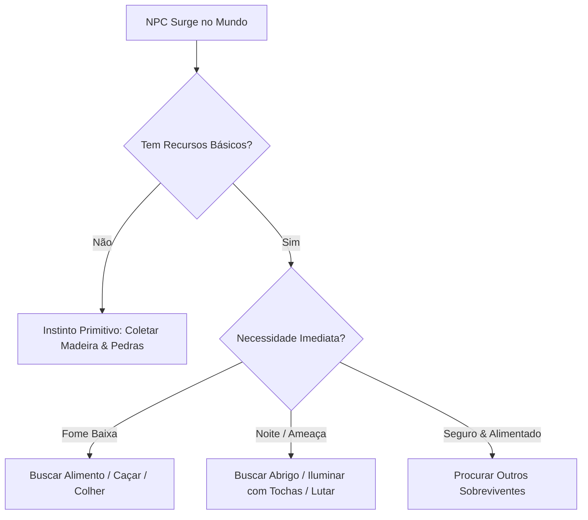
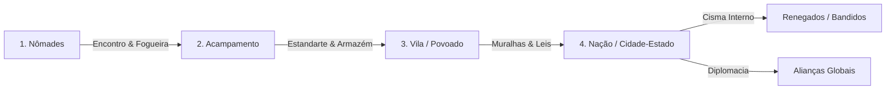
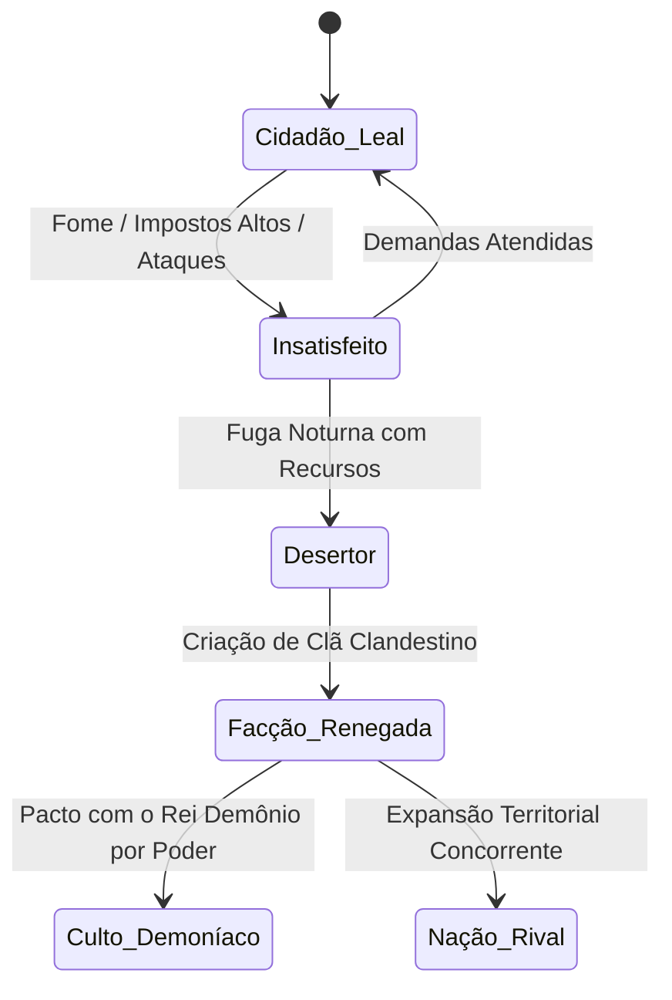
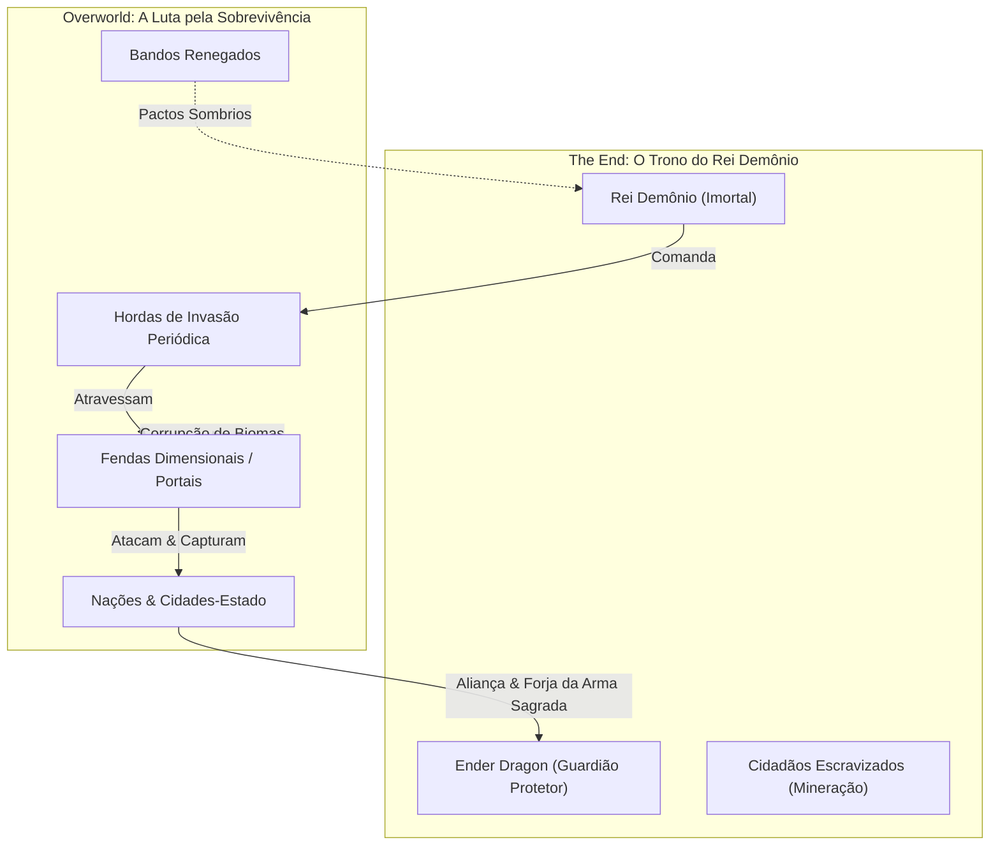

# Visão de Game Design: Sobrevivência, Sociedade & Ameaça Demoníaca

> Documento de referência para a evolução dos NPCs de sobreviventes individuais a civilizações geopolíticas vivas, em constante confronto com a corrupção do Rei Demônio.

---

## 1. O Cidadão como "Jogador Survival" (Autonomia Individual)

Para que os NPCs transmitam a sensação de serem jogadores humanos reais, eles não devem depender de comandos externos constantes. Eles possuem instintos básicos de sobrevivência no Minecraft:

### Instintos e Ciclo de Sobrevivência
1. **Progressão Pessoal de Ferramentas:**
   - Madeira $\rightarrow$ Pedra $\rightarrow$ Ferro $\rightarrow$ Diamante.
   - O NPC fabrica sua própria `crafting_table`, fornalha para assar carne ou fundir minérios, e tochas para iluminar sua área.
2. **Auto-preservação:**
   - **Noite / Tempestade:** Se não houver vila por perto, escavam uma pequena toca ou constroem uma cabana temporária de 3x3 de terra/pedra e colocam uma tocha.
   - **Combate Emergencial:** Fogem de Creepers prestes a explodir, usam escudos se possuírem no inventário secundário e comem para regenerar vida.

---

## 2. Da Sobrevivência à Nação: Ciclo de Emergência Social

### As 4 Fases de Desenvolvimento
1. **Fase Nômade:** Cidadãos solitários explorando o terreno em busca de comida e abrigo.
2. **Acampamento Coletivo:** Ao se encontrarem, dois ou mais NPCs montam uma fogueira (`campfire`). Dividem tarefas primitivas: um foca em buscar comida, outro em madeira.
3. **Fundação da Nação:**
   - Erguem o **Estandarte Central**.
   - O primeiro armazém comunal (`Storager`) é construído.
   - Os membros adotam especializações oficiais (Lenhador, Minerador, Construtor, Fazendeiro, Guarda).
4. **Maturidade Urbana:**
   - Criação de muralhas, pavimentação de ruas, iluminação pública contra monstros e colocação do **Mural de Necessidades da Nação**.

---

## 3. Dinâmica Política, Moral e Cismas (Renegados)

As civilizações não são colmeias perfeitas; elas têm atritos, ambições e descontentamento.

### Liderança Política
Conforme a nação cresce, um cidadão assume o papel de **Líder / Político** (por antiguidade, carisma ou votação simbólica):
- **O Militarista:** Prioriza armaduras de ferro, recrutamento de guardas e expansão de território.
- **O Construtor / Faraó:** Prioriza monumentos, muralhas espessas e tributos altos de pedra/madeira.
- **O Agrário / Humanista:** Prioriza abundância de fazendas, celeiros cheios e conforto dos cidadãos.
- **O Tirano:** Confisca recursos para si ou projetos megalomaníacos, reduzindo a moral pública.

### Sistema de Moral e o Surgimento de Renegados
- **Gatilhos de Insatisfação:**
  - Fome prolongada ou falta de comida no armazém.
  - Morte de companheiros por invasões sem proteção de guardas.
  - Sensação de opressão (excesso de horas de trabalho ou armazém trancado).
- **Acontecimentos Emergentes:**
  - **Fuga e Deserção:** O cidadão rouba itens do baú de suprimentos durante a madrugada e foge para longe das fronteiras.
  - **Bandos Renegados:** Renegados se juntam em esconderijos (cavernas, florestas densas) e atacam lenhadores ou mineradores isolados para saquear ferramentas.
  - **Pacto Demoníaco:** Renegados abandonados e desesperados podem ouvir os sussurros do Rei Demônio, tornando-se cultistas que sabotam tochas da vila e abrem os portões durante os ataques das hordas.

---

## 4. O Rei Demônio: O Relógio da Extinção

O Rei Demônio atua como um **catalisador de urgência global**, impedindo que o mundo entre em calmaria eterna e forçando decisões políticas difíceis:

### O Dilema Geopolítico:
1. **Guerra Civil vs Sobrevivência:**
   - As nações vão guerrear entre si por minas de ferro e terras férteis, ou formarão uma **Aliança Global** para resistir às hordas?
2. **Resgate de Cidadãos:**
   - Cidadãos capturados não morrem no vácuo: estão construindo a fortaleza do Fim. Resgatá-los traz trabalhadores experientes de volta.
3. **A Forja da Arma Sagrada:**
   - Derrotar o Rei Demônio exige tecnologia e recursos combinados que nenhuma nação sozinha consegue produzir facilmente (ex: ferro refinado do melhor ferreiro, essências místicas, ouro dos templos e a queda prévia do Ender Dragon).

---

## 5. Arquitetura Técnica & Escalabilidade (Fabric)

Para manter 60+ NPCs e múltiplas vilas rodando a **20 TPS** sem travamentos:
- **Modelo de Simulação em Dois Níveis:**
  - **Nível Físico (Perto do Jogador):** Entidades ativas no mundo, física completa, animações, A* Pathfinding otimizado com cache.
  - **Nível Virtual / Abstrato (Chunks Descarregados):** Cidadãos e nações distantes são apenas dados (`PersistentState`). A produção de madeira, plantações e crescimento do império demoníaco avança por fórmulas matemáticas periódicas a cada X minutos, consumindo quase zero de CPU.
- **Comportamentos Orientados a Objetivos (GOAP / Utility AI):**
  - Cada NPC avalia suas necessidades (`Hunger`, `Danger`, `WorkDuty`, `SocialMorale`) e escolhe a ação de maior pontuação no momento, tornando seu comportamento orgânico e imprevisível.
